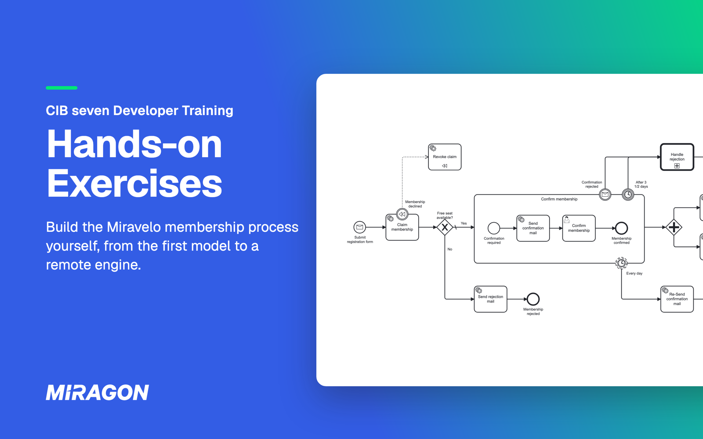

# CIB seven Developer Training: Übungen

[](https://github.com/miragon-trainings/cibseven-developer-training-exercises/actions/workflows/build.yml)
[](https://cib-seven.trainings.miragon.io/)
[](LICENSE)
[](README.md)



Der praktische Teil von Miragons CIB seven Developer Training: Du bringst einen Geschäftsprozess von der Whiteboard-Skizze zur getesteten Spring-Boot-Anwendung auf [CIB seven](https://cibseven.org), der Open-Source-Fortführung von Camunda 7.

## Warum

> *„Das ist doch in einer Stunde gebaut."*
> — Jede Entwicklerin und jeder Entwickler, die je ein Anmeldeformular unterschätzt haben.

Die Slides zeigen, was eine Process Engine kann; hier findest du heraus, was es dafür braucht. Am Ende hast du die Wartezustände, Timeouts und Rollbacks selbst erlebt.

## Was du bekommst

- **Eine Geschichte.** MiraVelo, ein Shop für Premium-Fahrräder, öffnet tausend Plätze im *Inner Circle*: Registrierung, Double Opt-in, Willkommens-Mail.
- **Eine echte Anwendung, kein Spielzeug.** Du arbeitest in einem Spring-Boot-Modul mit hexagonaler Architektur, und ArchUnit meldet sich, sobald die Engine in deine Domäne durchsickert.
- **Zwei Sprachen.** Jede Aufgabe hat eine Schritt-für-Schritt-Anleitung auf [Deutsch](docs/de/exercise-00.md) und [Englisch](docs/en/exercise-00.md).
- **Keine Engine, keine Datenbank zu installieren.** Beide starten mit der Anwendung.

## Die Aufgaben

| # | Thema | Du baust |
|---|---|---|
| [0](docs/de/exercise-00.md) | Den Mitgliedschaftsablauf fachlich modellieren | Den Membership-Ablauf als Modell, noch ohne Code |
| [1](docs/de/exercise-01.md) | Die Engine zum Laufen bringen | Die eingeschaltete Engine, einen ersten Prozess im Cockpit, einen Blick in die `act_*`-Tabellen |
| [2](docs/de/exercise-02.md) | User Task und Service Task | Ein Formular zum Bestätigen, einen JavaDelegate für die Willkommens-Mail |
| [3](docs/de/exercise-03.md) | Die Anwendung übernimmt | REST-Endpunkte, Message-Korrelation, Persistenz und eine Kapazitätsprüfung |
| [4](docs/de/exercise-04.md) | Den Prozess mit Tests absichern | Tests auf einer In-Memory-Engine, dazu einen Coverage-Report |
| [4 · Add-on](docs/de/exercise-04-addon.md) | Von Strings zu typsicheren Konstanten | Optional: generierte Konstanten statt händisch getippter Element-IDs |
| [5](docs/de/exercise-05.md) | Subprozess, Boundary Events und Parallelität | Tägliche Erinnerungen, einen Timeout, einen Rückzug und eine Begrüßung in Teams |
| [6](docs/de/exercise-06.md) | Kompensation, Call Activity und DMN | Einen kompensierten Platz-Claim, einen Ablehnungsprozess mit Entscheidungstabelle |
| [7](docs/de/exercise-07.md) | Die Engine als geteilte Infrastruktur | Einen Logistik-Service, der seinen eigenen Prozess auf der geteilten Engine besitzt |
| [Extra 1](docs/de/extra-task-1.md) | Raus aus dem Engine-Lock-in | Optional: Aufgabe 7 noch einmal, gegen eine engine-neutrale API |

## Loslegen

Du brauchst JDK 21, Git, IntelliJ IDEA oder VS Code und den Miragon BPMN Modeler, den du in [Aufgabe 0](docs/de/exercise-00.md) installierst. Der [Setup-Guide](https://cib-seven.trainings.miragon.io/setup) im Training-Hub führt dich durch; die Zugangsdaten hat dein Trainer oder deine Trainerin.

```bash
git clone https://github.com/miragon-trainings/cibseven-developer-training-exercises.git
cd cibseven-developer-training-exercises
./mvnw clean install
```

Der erste Build lädt Maven herunter und endet mit `BUILD SUCCESS`; in cmd.exe nimmst du `mvnw.cmd`. Dann öffne [Aufgabe 0](docs/de/exercise-00.md).

## Eine Aufgabe aufholen

Im Wurzelordner des Repos, bei gestoppter Anwendung, lädst du den Stand „Aufgabe 2 gelöst“, um mit Aufgabe 3 weiterzumachen:

```bash
./mvnw -pl services/process-application antrun:run@load-solution -Dsolution=02
```

Gültig sind `01` bis `07`; `00` bringt dich zurück zum Anfang. Deine eigenen Änderungen landen vorher in `services/process-application/.load-solution-backup/`. Lade danach das Maven-Projekt neu; bist du zu einer früheren Aufgabe zurückgegangen, setze auch die Datenbank zurück. Extra 1 und den Logistik-Service aus Aufgabe 7 lädt der Befehl nicht; ihre Lösungen liegen in [`solutions/`](solutions/).

## Wenn es hakt

- **Mit leerer Datenbank starten:** Anwendung stoppen und den Ordner `.cibseven-training` in deinem Home-Verzeichnis löschen.
- **„Database may be already in use“:** Ein anderes Modul oder eine Lösung läuft noch; stoppe es.
- **Roter Code in IntelliJ unter WSL oder Git Bash:** In IntelliJs Maven-Einstellungen **Maven home path** auf **Bundled (Maven 3)** stellen und das Projekt neu laden.
- **Roter Code in VS Code:** In der Befehlspalette **Java: Clean Java Language Server Workspace** ausführen.

## Hilfe und Feedback

- **Während des Trainings:** Frag deinen Trainer oder deine Trainerin.
- **Fehler in einer Aufgabe:** [Issue eröffnen](https://github.com/miragon-trainings/cibseven-developer-training-exercises/issues).

## Mitwirken

Wie das Repository gebaut wird, wie die Lösungen synchron bleiben und wie du eine Aufgabe änderst, steht in [CONTRIBUTING.md](CONTRIBUTING.md) (Englisch).

## Lizenz

[MIT](LICENSE) © Miragon
