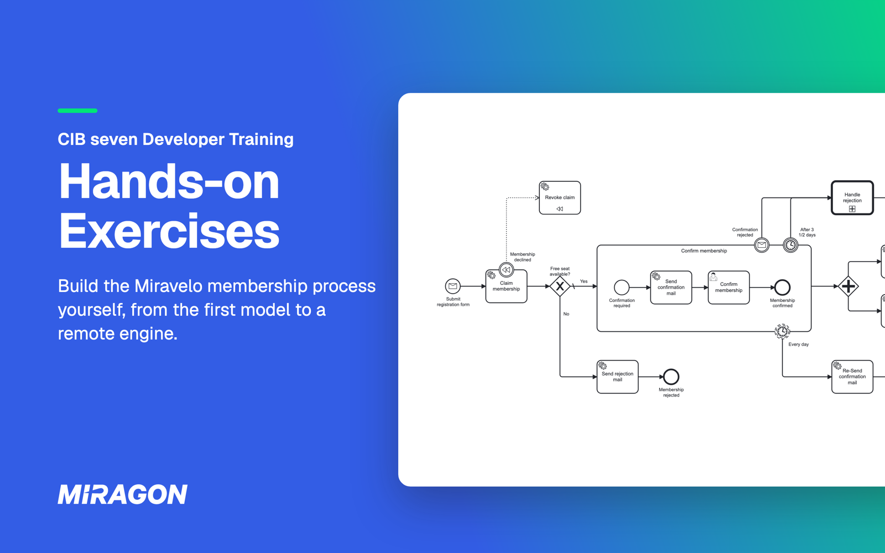

# CIB seven Developer Training: Exercises

[](https://github.com/miragon-trainings/cibseven-developer-training-exercises/actions/workflows/build.yml)
[](https://cib-seven.trainings.miragon.io/)
[](LICENSE)
[](README.de.md)



The hands-on half of Miragon's CIB seven Developer Training: you take one business process from a whiteboard sketch to a tested Spring Boot application on [CIB seven](https://cibseven.org), the open-source continuation of Camunda 7.

## Why

> *"Surely that's built in an hour."*
> — Every developer who has ever underestimated a sign-up form.

Slides show you what a process engine can do; this repo is where you find out what it takes. By the end you have hit the waits, the timeouts and the rollbacks yourself.

## What you get

- **One story.** Miravelo, a premium bike shop, opens a thousand *Inner Circle* membership seats: registration, double opt-in, welcome mail.
- **A real application, not a toy.** You work in one Spring Boot module with a hexagonal architecture, and ArchUnit tells you when the engine leaks into your domain.
- **Two languages.** Every exercise has a step-by-step guide in [English](docs/en/exercise-00.md) and [German](docs/de/exercise-00.md).
- **No engine or database to install.** Both start with the application.

## The exercises

| # | Topic | You build |
|---|---|---|
| [0](docs/en/exercise-00.md) | Business-level BPMN | The membership flow as a model, before any code |
| [1](docs/en/exercise-01.md) | Getting the engine running | The engine switched on, a first process in the Cockpit, a look at the `act_*` tables |
| [2](docs/en/exercise-02.md) | User Task and Service Task | A form to confirm, a JavaDelegate that sends the welcome mail |
| [3](docs/en/exercise-03.md) | The application takes over | REST endpoints, message correlation, persistence and a capacity check |
| [4](docs/en/exercise-04.md) | Process tests | Tests on an in-memory engine, plus a coverage report |
| [4 · Add-on](docs/en/exercise-04-addon.md) | bpmn-to-code (optional) | Generated constants instead of hand-typed element IDs |
| [5](docs/en/exercise-05.md) | Subprocess, boundary events, parallelism | Daily reminders, a timeout, a withdrawal and a Teams welcome |
| [6](docs/en/exercise-06.md) | Compensation, call activity, DMN | A compensated seat claim, a rejection process with a decision table |
| [7](docs/en/exercise-07.md) | Remote engine | A logistics service that owns its own process on the shared engine |
| [Extra 1](docs/en/extra-task-1.md) | Process Engine API (optional) | Exercise 7 rewritten against an engine-neutral API |

## Get started

You need JDK 21, Git, IntelliJ IDEA or VS Code, and the Miragon BPMN Modeler that [Exercise 0](docs/en/exercise-00.md) installs. The [setup guide](https://cib-seven.trainings.miragon.io/en/setup) on the training hub walks you through it; your trainer has the sign-in.

```bash
git clone https://github.com/miragon-trainings/cibseven-developer-training-exercises.git
cd cibseven-developer-training-exercises
./mvnw clean install
```

The first build downloads Maven and ends with `BUILD SUCCESS`; in cmd.exe use `mvnw.cmd`. Then open [Exercise 0](docs/en/exercise-00.md).

## Catch up on an exercise

From the repository root, with the application stopped, load the state "Exercise 2 solved" to start Exercise 3:

```bash
./mvnw -pl services/process-application antrun:run@load-solution -Dsolution=02
```

Values run from `01` to `07`; `00` takes you back to the start. Your own changes are backed up to `services/process-application/.load-solution-backup/` first. Reload the Maven project afterwards; after going back to an earlier exercise, also reset the database. Extra 1 and Exercise 7's logistics service can't be loaded this way; their solutions are in [`solutions/`](solutions/).

## If something gets stuck

- **Start from a clean database:** stop the application and delete the `.cibseven-training` folder in your home directory.
- **"Database may be already in use":** another module or a solution is still running; stop it.
- **Red code in IntelliJ on WSL or Git Bash:** set **Maven home path** to **Bundled (Maven 3)** in IntelliJ's Maven settings and reload the project.
- **Red code in VS Code:** run **Java: Clean Java Language Server Workspace** from the Command Palette.

## Help and feedback

- **During the training:** ask your trainer.
- **Mistakes in an exercise:** [open an issue](https://github.com/miragon-trainings/cibseven-developer-training-exercises/issues).

## Contributing

How the repository is built, how solutions stay in sync and how to change an exercise is in [CONTRIBUTING.md](CONTRIBUTING.md).

## License

[MIT](LICENSE) © Miragon
