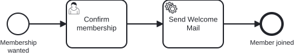

# Aufgabe 2 – User Task und Service Task

> **Voraussetzung:** Aufgabe 1 ist abgeschlossen – die Engine startet und deployt `membership.bpmn`.
> **Arbeitsverzeichnis:** `services/process-application`
> **Neu in dieser Aufgabe:** Prozess-Key, Element-ID, User Task, Wait State, Generated Form am User Task, Service Task, JavaDelegate, Delegate Expression.

## Darum geht es

Der Prozess aus Aufgabe 1 läuft durch, ohne dass jemand etwas tut: „Confirm" wartet auf niemanden,
„Send welcome mail" verschickt nichts. Du machst aus dem einen Platzhalter einen **User Task**, an
dem die Instanz auf einen Menschen wartet, und aus dem anderen einen **Service Task**, den dein
Java-Code ausführt.

> *„Ein Task, der nicht wartet, ist kein Task – der ist Durchgangsverkehr."*

## Lernziele

Nach dieser Aufgabe kannst du

- einen Manual Task in einen **User Task** mit selbst erstellter Generated Form umwandeln,
- einen **Wait State** in den Runtime-Tabellen (`act_ru_execution`, `act_ru_task`) wiederfinden,
- einen Service Task über eine **Delegate Expression** an einen **JavaDelegate** binden,
- die Schichten einer Ausführung benennen: Delegate → Use Case → Service.

## Ziel-Modell



Referenzmodell: `../../models/exercise-02/membership.bpmn`

## Aufgabe

### 1. Delegate-Schicht einkommentieren

Kommentiere die Klassen mit `TODO Exercise 2` ein:

- `application/port/inbound/SendWelcomeMailUseCase.java`
- `application/service/SendWelcomeMailService.java`
- `adapter/inbound/cibseven/BaseDelegate.java`
- `adapter/inbound/cibseven/SendWelcomeMailDelegate.java`

Use Case, Service und `BaseDelegate` sind danach fertig. Der Delegate trägt weiterhin ein `TODO`,
die Engine-Anbindung schreibst du in Schritt 4 selbst.

### 2. „Confirm" in einen User Task umwandeln

Öffne `src/main/resources/bpmn/membership.bpmn` im Miragon BPMN Modeler. Alle Änderungen machst du
dort im Properties Panel, nicht im XML. Wirf zuerst einen Blick auf die Prozess-Eigenschaften: Der
**Prozess-Key** `subscribeNewsletter` ist der Name, unter dem die Engine den Prozess kennt (ein
historischer Name, er bleibt so). `Executable` ist aktiv, `History Time To Live` steht auf `180`.

Ändere den Typ von „Confirm" auf **User Task** und lege unter **Forms** eine Generated Form an:

| Element | Typ | Element-ID | Name |
|---|---|---|---|
| Bestätigung | User Task | `userTask_confirmMembership` | Confirm membership |

| Feld-ID | Label | Typ |
|---|---|---|
| `email` | E-Mail | string |
| `confirmed` | Confirm membership | boolean |

`email` wird aus der gleichnamigen Prozessvariable des Start-Formulars vorbefüllt. `confirmed` wird
beim Abschließen als neue Prozessvariable gespeichert.

### 3. „Send welcome mail" in einen Service Task umwandeln

Ändere den Typ von „Send welcome mail" auf **Service Task** und binde ihn an den Delegate:

| Element | Typ | Element-ID | Name | Delegate Expression |
|---|---|---|---|---|
| Willkommens-Mail | Service Task | `serviceTask_sendWelcomeMail` | Send Welcome Mail | `#{sendWelcomeMailDelegate}` |

Die Delegate Expression nennt die Spring-Bean, die die Engine aufruft, wenn die Instanz diesen Task
erreicht.

### 4. `SendWelcomeMailDelegate` implementieren

Ersetze das `TODO` in `executeTask(execution)` in
`adapter/inbound/cibseven/SendWelcomeMailDelegate.java`:

- Lies die Prozessvariable `email` aus der `DelegateExecution`.
- Rufe damit `useCase.sendWelcomeMail(...)` auf.

### 5. Den Wait State ansehen

Starte die Anwendung neu, damit das geänderte Modell deployt wird:

```bash
cd services/process-application && ../../mvnw spring-boot:run
```

Starte in der Tasklist (`Start process` → `Join Inner Circle`) eine Instanz und fülle das
Start-Formular aus. Die Instanz bleibt jetzt am User Task stehen. Öffne die H2-Konsole mit denselben
Zugangsdaten wie in Aufgabe 1 und frage die Runtime-Tabellen ab:

```sql
SELECT id_, proc_def_id_ FROM act_ru_execution;
SELECT id_, name_ FROM act_ru_task;
```

Beide liefern eine Zeile: die wartende Instanz und den offenen Task `Confirm membership`.

> **Begriff: Wait State.** Eine Stelle, an der die Prozessinstanz anhält und auf ein Ereignis von
> außen wartet, hier auf den Abschluss des User Tasks. Die Engine speichert den Zustand in den
> `act_ru_*`-Tabellen und gibt den Thread frei, deshalb übersteht eine wartende Instanz auch einen
> Neustart. Ein Manual Task ist kein Wait State.

### 6. Den User Task abschließen

Öffne `Confirm membership` in der Tasklist: `email` ist vorbefüllt. Setze den Haken bei `confirmed`
und schließe den Task ab.

## Randbedingungen

- **Element-ID-Konvention**, ab jetzt verbindlich: `startEvent_`, `endEvent_`, `userTask_`,
  `serviceTask_`, `manualTask_`, `gateway_`, `subProcess_`, `boundaryEvent_`.
- Der Delegate ist ein Adapter: Er liest Prozessvariablen und ruft einen Use Case auf. Fachlogik
  gehört in den Service.
- Gestartet und bestätigt wird weiterhin über das Cockpit.

## Erwartetes Ergebnis

Nach dem Abschließen des User Tasks läuft der Service Task, und im Log erscheint:

```
Sending welcome mail to alice@miravelo.com
```

Die Instanz endet an `Member joined`, die beiden Abfragen aus Schritt 5 liefern keine Zeile mehr.

## Selbstcheck

- [ ] `userTask_confirmMembership` ist ein User Task mit einer Generated Form (`email`, `confirmed`)
- [ ] Eine gestartete Instanz wartet am User Task, `act_ru_task` enthält eine Zeile
- [ ] `serviceTask_sendWelcomeMail` nutzt `#{sendWelcomeMailDelegate}`
- [ ] Der Delegate liest `email` aus der `DelegateExecution` und ruft den Use Case auf
- [ ] Nach dem Abschließen steht die Log-Zeile im Log, und die Instanz endet an `Member joined`

## Hinweise

Warum die Trennung von Delegate und Service? Der Delegate kennt die Engine (`DelegateExecution`,
Prozessvariablen), der Service nur die Fachlichkeit. So bleibt die Fachlogik ohne Engine testbar,
das nutzt du in [Aufgabe 4](exercise-04.md) beim Prozess-Test.

## Referenzlösung

`../../solutions/exercise-02/` – oder direkt laden:

```bash
./mvnw -pl services/process-application antrun:run@load-solution -Dsolution=02
```

## Nächster Schritt

In Aufgabe 3 übernimmt die Anwendung: Registrierung und Bestätigung per REST, Start über eine
Nachricht und eine Kapazitätsprüfung mit Gateway.

➡️ [Weiter zu Aufgabe 3](exercise-03.md)
