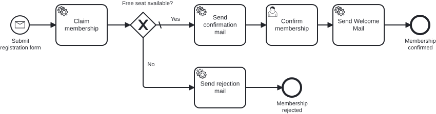

# Aufgabe 4 – Den Prozess mit Tests absichern

> **Voraussetzung:** Aufgabe 3 ist abgeschlossen – Gateway, Kapazitätsprüfung und beide Prozessausgänge laufen.
> **Arbeitsverzeichnis:** `services/process-application`
> **Neu in dieser Aufgabe:** Transaktionsgrenzen (`asyncBefore`/`asyncAfter`), In-Memory-Engine mit H2, abgeschalteter Job Executor, `@MockitoBean`, Assertions mit `BpmnAwareTests`.

## Darum geht es

In der Cockpit-Demo hat der Prozess einmal funktioniert. Ob er nächste Woche noch funktioniert,
wenn jemand einen Sequenzfluss umbiegt oder eine Bedingung dreht, weiß niemand. Ein **Prozess-Test**
startet den echten Prozess in einer In-Memory-Engine, lässt die echten Delegates laufen und ersetzt
nur die Fachlogik dahinter durch Mocks. Welchen Weg die Instanz nehmen muss, steht dann als
Assertion im Test und wird bei jedem Build geprüft. Vorher machst du den Prozess mit
Transaktionsgrenzen robust.

> *„Works on my machine" ist kein Testkonzept. Es ist eine Ausrede mit besserer PR.*

## Lernziele

Nach dieser Aufgabe kannst du

- Transaktionsgrenzen setzen und begründen, warum ein nicht wiederholbarer Schritt vor einem externen Effekt committen muss,
- einen Prozess als Unit-Test auf einer In-Memory-Engine mit abgeschaltetem Job Executor absichern,
- die Use Cases hinter den Delegates mit `@MockitoBean` mocken,
- Prozesspfade mit `BpmnAwareTests` prüfen (`isWaitingAt`, `hasPassedInOrder`, `isEnded`).

## Ziel-Modell



Es kommen keine neuen Elemente dazu, nur Transaktionsgrenzen am Prozess aus Aufgabe 3.

Referenzmodell: `../../models/exercise-04/membership.bpmn`

## Aufgabe

### 1. Transaktionsgrenzen setzen

Theorie dazu steht im Trainingskapitel **„Async & Transaction Boundaries"**. Bisher läuft der Prozess
synchron. Die Engine committet automatisch an jedem Wait State. Überall sonst setzt du eine Grenze
mit einer **asynchronen Continuation**: `asyncBefore` oder `asyncAfter` lassen die Engine an dieser
Stelle committen, einen Job anlegen und die Arbeit in einer neuen Transaktion fortsetzen. Du findest
die Marker im Properties Panel unter *Asynchronous Before/After*.

Zwischen Message Start und User Task liegt kein Wait State. Ohne Marker laufen `claimMembership` und
`sendConfirmationMail` in einer Transaktion. Wirft der Mailversand, rollt die Engine alles zurück und
wiederholt den Job, und der Platz wird doppelt reserviert. Die Regel: Trenne nicht wiederholbare
Arbeit durch eine eigene Grenze vom externen Effekt.

| Marker | Element | Warum |
|---|---|---|
| `asyncBefore` | `startEvent_submitRegistration` | Die Korrelation legt nur die Instanz an und kehrt zurück |
| `asyncAfter` | `userTask_confirmMembership` | Die Completion committet sofort, statt bei einem Fehler im nächsten Task mit zurückzurollen |
| `asyncBefore` | `serviceTask_sendConfirmationMail` | Die Reservierung committet zuerst, ein Mail-Fehler wiederholt nur den Versand |
| `asyncBefore` | `serviceTask_sendRejectionMail` | liegt sonst in derselben Transaktion wie `claimMembership` |
| `asyncBefore` | `serviceTask_sendWelcomeMail` | externer Effekt, wie alle Mail-Tasks |

`claimMembership` bekommt keinen Marker: Er committet gemeinsam mit dem **Token**, der gedachten
Spielfigur, die den aktuellen Stand einer Instanz im Modell markiert.

### 2. Test-Dependency aktivieren

Kommentiere in `services/process-application/pom.xml` den Block `TODO Exercise 4` ein. Wie in
Aufgabe 1 löschst du nur die Zeilen `<!--` und `-->` zwischen `@exercise-4:begin` und
`@exercise-4:end`. Danach ist diese Dependency aktiv:

```xml
<dependency>
    <groupId>org.cibseven.bpm</groupId>
    <artifactId>cibseven-bpm-assert</artifactId>
    <scope>test</scope>
</dependency>
```

### 3. Testprofil anlegen

Lege `src/test/resources/application-test.yaml` an. Das Profil `test` lässt die Engine auf einer
eigenen In-Memory-H2 laufen und schaltet den Job Executor ab:

```yaml
spring:
  main:
    allow-bean-definition-overriding: true
  datasource:
    url: jdbc:h2:mem:cibseven-test;DB_CLOSE_DELAY=-1
    username: sa
    password:
    driver-class-name: org.h2.Driver
  jpa:
    hibernate:
      ddl-auto: create-drop

camunda:
  bpm:
    admin-user:
      id: admin
      password: admin
    database:
      type: h2
      schema-update: true
    job-execution:
      enabled: false   # die Async-Continuations führt der Test selbst aus
    webapp:
      enabled: false

# Die Webapp validiert dieses Secret beim Start, auch wenn sie abgeschaltet ist
cibseven:
  webclient:
    authentication:
      jwtSecret: M9nU3ORo3s+gK23D9mO5I2h+EIqnosCFDCJi+2bKoulKqZkeQT8pGYg5RhuORlf/fWhLu5meC/SPZCv9NNuj6SK/vE5Sid04UQGrnyh04EpBdiAosAO91xezjgmbSeALUtneibseGpS0tNE4RvLIl+gXiAKqNXyO
```

> **Begriff: Job Executor.** Der Hintergrund-Thread der Engine, der die Jobs aus asynchronen
> Continuations abarbeitet. Im Test weißt du dadurch nie, wie weit die Instanz gerade ist. Deshalb
> ist er abgeschaltet, und der Test führt die Jobs selbst aus.

### 4. Happy-Path-Test schreiben

Ersetze den Platzhalter in `src/test/java/io/miragon/training/process/MembershipProcessTest.java`
(markiert mit `TODO Exercise 4`). Für das Treiben der Instanz nutzt du den vorgegebenen Helfer
`process/util/ProcessEngineTestUtils`:

- `continueToNextWaitState(processEngine)` führt die offenen Jobs aus, bis die Instanz den nächsten
  Wait State oder ihr Ende erreicht.
- `findProcessInstance(runtimeService, membershipId)` sucht die Instanz zur `membershipId`.

Das Gerüst ist für jeden Prozess-Test gleich:

```java
@SpringBootTest
@ActiveProfiles("test")
class MembershipProcessTest {

    @Autowired private MembershipProcess membershipProcess;
    @Autowired private RuntimeService runtimeService;
    @Autowired private TaskService taskService;
    @Autowired private ProcessEngine processEngine;

    @MockitoBean private ClaimMembershipUseCase claimMembershipUseCase;
    @MockitoBean private SendConfirmationMailUseCase sendConfirmationMailUseCase;
    @MockitoBean private SendRejectionMailUseCase sendRejectionMailUseCase;
    @MockitoBean private SendWelcomeMailUseCase sendWelcomeMailUseCase;

    @BeforeEach
    void setUp() {
        init(processEngine); // BpmnAwareTests.init(...)
    }
}
```

Der Happy Path folgt der Form Given – When – Then. Ersetze jeden Platzhalter `"<…>"` durch die
Element-ID aus deinem Modell:

```java
@Test
void happyPath_membershipIsConfirmedAndWelcomeMailIsSent() {
    // Given: die Kapazitätsprüfung gewährt einen Platz
    when(claimMembershipUseCase.claimMembership(any())).thenReturn(true);

    // When: die Instanz startet und läuft bis zum ersten Wait State
    Membership membership = new Membership(new Email("jane@example.com"), new Name("Jane"), new Age(30));
    membershipProcess.startProcess(membership);
    ProcessInstance instance = findProcessInstance(runtimeService, membership.id().value().toString());
    continueToNextWaitState(processEngine);

    // Then: die Instanz wartet am User Task
    assertThat(instance).isWaitingAt("<user-task-id>");

    // When: der User Task wird abgeschlossen
    String taskId = taskService.createTaskQuery()
            .processInstanceId(instance.getProcessInstanceId()).singleResult().getId();
    taskService.complete(taskId);
    continueToNextWaitState(processEngine);

    // Then: die Instanz endet über den Bestätigungspfad
    assertThat(instance)
            .isEnded()
            .hasPassedInOrder("<start>", "<…Aktivitäten des Bestätigungspfads, in Reihenfolge…>", "<confirmed-end>")
            .hasNotPassed("<reject-activity>", "<rejected-end>");

    verify(sendWelcomeMailUseCase).sendWelcomeMail(membership.id());
}
```

### 5. Ablehnungspfad testen

Schreibe den zweiten Test `noCapacity_membershipIsRejected`: `claimMembership` liefert `false`, die
Instanz läuft ohne Wait State bis `endEvent_membershipRejected`. Prüfe, dass die Ablehnungs-Mail
durchlaufen wurde, Bestätigung und Willkommens-Mail nicht, und dass `sendWelcomeMailUseCase` nie
aufgerufen wurde (`verify(..., never())`).

## Randbedingungen

- Der Test braucht keine laufende Anwendung. Die In-Memory-H2 wird pro Testlauf frisch angelegt und
  ist unabhängig von den Daten unter `~/.cibseven-training`.
- Gemockt werden nur die Use Cases. Delegates, Modell und Engine laufen echt.
- Die Element-IDs stehen als Strings im Test. Das [Add-on](exercise-04-addon.md) ersetzt sie durch
  generierte Konstanten.

## Erwartetes Ergebnis

Führe die Testklasse aus dem Wurzelverzeichnis aus:

```bash
./mvnw -pl services/process-application test -Dtest=MembershipProcessTest
```

Beide Tests laufen in wenigen Sekunden durch. Schlägt einer fehl, zeigt die Assertion, an welcher
Aktivität die Instanz tatsächlich stand.

## Selbstcheck

- [ ] `asyncBefore` steht am Message Start Event und an den drei Mail-Tasks, `asyncAfter` am User Task, `claimMembership` hat keinen Marker
- [ ] Im Testprofil ist der Job Executor abgeschaltet
- [ ] Der Happy-Path-Test prüft die Reihenfolge und die nicht genommenen Pfade
- [ ] Der Ablehnungstest prüft, dass die Willkommens-Mail nie aufgerufen wurde
- [ ] Beide Tests laufen grün, ohne dass die Anwendung gestartet ist

## Hinweise

**Idempotenz:** Ein Retry darf einen Service Task erneut ausführen. Darf eine Aktion nur einmal
passieren (Reservierung, Zahlung), muss sie vor der Grenze committen oder idempotent sein.

## Referenzlösung

`../../solutions/exercise-04/` – oder direkt laden:

```bash
./mvnw -pl services/process-application antrun:run@load-solution -Dsolution=04
```

Die Lösung enthält beide Varianten: `MembershipProcessPlainTest` mit ID-Strings und
`MembershipProcessTest` mit der generierten Process-API aus dem Add-on.

## Nächster Schritt

Die Element-IDs stehen noch als handgetippte Strings im Test. Das Add-on macht daraus geprüfte
Konstanten.

➡️ [Weiter zum Add-on: bpmn-to-code](exercise-04-addon.md)
