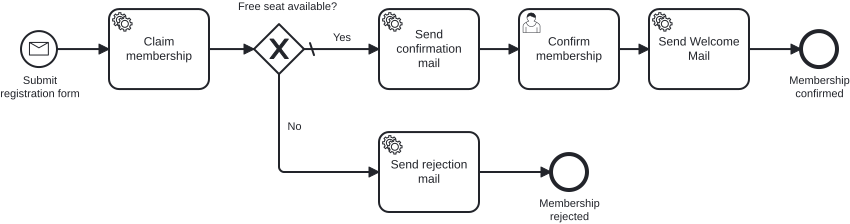

# Aufgabe 5 – Subprozess, Boundary Events und Parallelität

> **Voraussetzung:** Aufgabe 4 inklusive Add-on ist abgeschlossen – die Prozess-Tests laufen gegen die generierte Process-API.
> **Arbeitsverzeichnis:** `services/process-application`
> **Neu in dieser Aufgabe:** eingebetteter Subprozess, Timer Boundary Events (unterbrechend und nicht unterbrechend), Message Boundary Event, Parallel Gateway, ein Outbound-Adapter nach Microsoft Teams.

## Darum geht es

Viele Bewerberinnen und Bewerber bestätigen nie und blockieren damit Plätze. Miravelo will deshalb
täglich erinnern, nach dreieinhalb Tagen ohne Bestätigung automatisch abbrechen und einen Rückzug
per REST erlauben. Wer es bis zur Aktivierung schafft, wird parallel zur Willkommens-Mail in einem
**Microsoft-Teams-Kanal** der Community begrüßt.

## Lernziele

Nach dieser Aufgabe kannst du

- Aktivitäten in einem eingebetteten Subprozess zusammenfassen und Boundary Events daran anheften,
- unterbrechende und nicht unterbrechende Timer sowie ein Message Boundary Event einsetzen,
- zwei unabhängige Zweige über Parallel Gateways aufspannen und wieder zusammenführen,
- Transaktionsgrenzen an Boundary Events und Parallelzweigen setzen und die neuen Pfade testen.

## Ziel-Modell



Referenzmodell: `../../models/exercise-05/membership.bpmn`

## Aufgabe

### 1. Subprozess anlegen

Fasse Bestätigungs-Mail und Bestätigung im eingebetteten Subprozess `subProcess_confirmMembership`
(„Confirm membership") zusammen:

| Element | Typ | Element-ID | Name |
|---|---|---|---|
| Start | None Start Event | `startEvent_confirmationRequired` | – |
| Bestätigungs-Mail | Service Task | `serviceTask_sendConfirmationMail` | Send confirmation mail |
| Bestätigung | User Task | `userTask_confirmMembership` | Confirm membership |
| Ende | None End Event | `endEvent_membershipConfirmed` | Membership confirmed |

Ein unterbrechendes Boundary Event bricht die Aktivität ab, an der es hängt. Abgebrochen werden soll
die gesamte Bestätigung, deshalb hängen die Boundary Events am Subprozess und nicht an einem Task.

### 2. Boundary Events anhängen

Hänge alle drei an `subProcess_confirmMembership`:

| Element | Typ | Element-ID | Name | Konfiguration |
|---|---|---|---|---|
| Erinnerung | Timer, **nicht** unterbrechend | `event_resendEveryDay` | Every day | **Cycle** `R/P1D` |
| Timeout | Timer, unterbrechend | `event_abortAfter3HalfDays` | After 3½ days | **Duration** `P3DT12H` |
| Rückzug | Message, unterbrechend | `event_confirmationRejected` | Confirmation rejected | Message: `Message_ConfirmationRejected` |

Die Erinnerung braucht einen Cycle (`R/…`), eine Duration würde nur einmal feuern.

### 3. Neue Tasks und End Events modellieren

Ergänze die Pfade hinter den Boundary Events:

| Element | Typ | Element-ID | Name | Konfiguration |
|---|---|---|---|---|
| Erinnerungsmail | Service Task | `serviceTask_reSendConfirmationMail` | Re-Send confirmation mail | `#{reSendConfirmationMailDelegate}` |
| Platz freigeben | Service Task | `serviceTask_revokeClaim` | Revoke claim | `#{revokeClaimDelegate}` |
| Ende Erinnerung | End Event | `endEvent_mailSentAgain` | Mail sent again | Ende des Erinnerungszweigs |
| Ende Abbruch | End Event | `endEvent_membershipDeclined` | Membership declined | nach `Revoke claim` |
| Ende Aktivierung | End Event | `endEvent_membershipActivated` | Membership activated | nach dem Join |

Beide unterbrechenden Boundary Events führen auf `serviceTask_revokeClaim` und von dort auf
`endEvent_membershipDeclined`.

### 4. Parallel Gateway einsetzen

Setze zwischen das Ende des Subprozesses und `endEvent_membershipActivated` zwei Parallel Gateways:

| Element | Typ | Element-ID | Zweige |
|---|---|---|---|
| Fork | Parallel Gateway | `gateway_notifyFork` | → `serviceTask_sendWelcomeMail`, → `serviceTask_notifyCommunity` |
| Join | Parallel Gateway | `gateway_notifyJoin` | ← beide Zweige, → `endEvent_membershipActivated` |

Der neue Service Task `serviceTask_notifyCommunity` („Notify community") nutzt
`#{notifyCommunityDelegate}`. Der Join wartet auf beide Zweige.

### 5. Transaktionsgrenzen ergänzen

Setze die Marker nach demselben Prinzip wie in [Aufgabe 4](exercise-04.md):

| Marker | Element | Warum |
|---|---|---|
| `asyncAfter` | `event_resendEveryDay` | Die Erinnerung läuft in eigener Transaktion, der Subprozess wartet unberührt weiter |
| `asyncAfter` | `event_abortAfter3HalfDays` | saubere Grenze vor dem Abbruch |
| `asyncAfter` | `event_confirmationRejected` | dito für den Rückzug |
| `asyncBefore` | `serviceTask_reSendConfirmationMail` | externer Effekt, wie alle Mail-Tasks |
| `asyncBefore` | `serviceTask_sendWelcomeMail`, `serviceTask_notifyCommunity` | Ohne eigene Grenze würde ein fehlgeschlagener Teams-Aufruf auch die schon verschickte Willkommens-Mail wiederholen |

### 6. Use Cases und Delegates ergänzen

Lege nach dem bekannten Muster an:

- `ReSendConfirmationMailUseCase` / `ReSendConfirmationMailService`: loggt das erneute Verschicken.
- `RevokeClaimUseCase` / `RevokeClaimService`: loggt die Freigabe und gibt den Platz wieder frei.
- `ReSendConfirmationMailDelegate` / `RevokeClaimDelegate`: lesen `membershipId` und rufen den Use Case auf.

### 7. Rückzug per REST auslösen

Ergänze den Endpunkt `POST /api/memberships/{membershipId}/reject`. Er korreliert im
`MembershipProcessAdapter` die Nachricht `Message_ConfirmationRejected` über
`runtimeService.createMessageCorrelation(...)`, gefiltert auf die Prozessvariable `membershipId`.

### 8. Community-Benachrichtigung anbinden

Übernimm die folgenden Klassen aus der Referenzlösung. Aufbau der Adaptive Card und REST-Aufruf
sind Infrastruktur:

- `adapter/inbound/cibseven/NotifyCommunityDelegate`
- `application/port/inbound/NotifyCommunityUseCase`, `application/service/NotifyCommunityService`
- `application/port/outbound/NotificationPublisherOutPort`, `adapter/outbound/teams/MicrosoftTeamsMessagePublisher`
- `adapter/config/RestClientConfig`, `domain/Notification`

Die Webhook-URL kommt aus der `application.yaml`:

```yaml
notification:
  teams:
    # Echte URL per Umgebungsvariable TEAMS_WEBHOOK_URL – kein Secret ins Repository.
    webhook-url: ${TEAMS_WEBHOOK_URL:https://CHANGE-ME}
```

### 9. Prozess-Test erweitern

Nach `generate-sources` kompiliert der Happy Path nicht mehr: Hinter dem Gateway liegt jetzt der
Subprozess, hinter dem User Task der Fork. Navigiere ihn neu:

```java
var happyPath = PathWalk.from(FlowNodes.startEventSubmitRegistration())
        .then(next -> next.serviceTaskClaimMembership())
        .then(next -> next.gatewayHasEmptySpots())
        .onto(next -> next.subProcessConfirmMembership())
        .inside(FlowNodes.subProcessConfirmMembership(), start -> PathWalk.from(start.startEventConfirmationRequired())
                .then(next -> next.serviceTaskSendConfirmationMail())
                .then(next -> next.userTaskConfirmMembership())
                .end(next -> next.endEventMembershipConfirmed()))
        .then(next -> next.gatewayNotifyFork())
        .then(next -> next.serviceTaskSendWelcomeMail())
        .then(next -> next.gatewayNotifyJoin())
        .end(next -> next.endEventMembershipActivated());
```

`onto(...)` tritt auf den Subprozess, ohne ihn in den Pfad aufzunehmen, `inside(...)` läuft sein
Inneres ab. Ein geordneter Pfad folgt nur einem Zweig. Den parallelen Zweig prüfst du ungeordnet mit
`hasPassed(FlowNodes.ServiceTaskNotifyCommunity.ELEMENT_ID)`.

Ergänze drei Tests und mocke dafür `RevokeClaimUseCase`, `ReSendConfirmationMailUseCase` und
`NotifyCommunityUseCase`:

- **Timeout:** Feuere den Timer mit `fireTimer(processEngine, FlowNodes.EventAbortAfter3HalfDays.ELEMENT_ID)`
  aus `ProcessEngineTestUtils`, führe die offenen Jobs aus und prüfe den Pfad mit `hasPassedInOrder`:

  ```java
  var abortPath = PathWalk.from(FlowNodes.userTaskConfirmMembership())
          .interruptedBy(FlowNodes.subProcessConfirmMembership(), boundary -> boundary.eventAbortAfter3HalfDays())
          .then(next -> next.serviceTaskRevokeClaim())
          .end(next -> next.endEventMembershipDeclined());
  ```

- **Rückzug:** Rufe statt des Timers `membershipProcess.rejectMembership(id)` auf. Der Pfad läuft
  über `eventConfirmationRejected()`.
- **Erinnerung:** Feuere `FlowNodes.EventResendEveryDay.ELEMENT_ID` und prüfe, dass
  `reSendConfirmationMailUseCase` aufgerufen wurde und die Instanz weiter am User Task wartet.

## Randbedingungen

- Die Timer tragen die fachlichen Werte. Zum manuellen Beobachten setze sie vorübergehend auf
  `R/PT1M` und `PT3M`.
- Committe niemals eine echte Webhook-URL.

## Erwartetes Ergebnis

Lege eine Membership an und ziehe sie zurück:

```bash
MEMBERSHIP_ID=$(curl -s -X POST http://localhost:8080/api/memberships \
  -H "Content-Type: application/json" \
  -d '{"email": "eve@miravelo.com", "name": "Eve", "age": 26}')

curl -X POST http://localhost:8080/api/memberships/$MEMBERSHIP_ID/reject
```

`Revoke claim` läuft, die Instanz endet an `Membership declined`. Mit verkürzten Timern erscheint
vorher jede Minute die Erinnerungsmail im Log. Bestätigst du stattdessen mit
`POST /api/memberships/$MEMBERSHIP_ID/confirm`, laufen beide Parallelzweige, und die Instanz endet
an `Membership activated`.

## Selbstcheck

- [ ] Alle drei Boundary Events hängen am Subprozess, die Unterbrechungs-Semantik stimmt
- [ ] Beide unterbrechenden Pfade führen über `Revoke claim` zu `Membership declined`
- [ ] Fork und Join sind Parallel Gateways, beide Zweige tragen `asyncBefore`
- [ ] `POST /api/memberships/{id}/reject` bricht eine wartende Instanz ab
- [ ] Die drei neuen Prozess-Tests sind grün

## Referenzlösung

`../../solutions/exercise-05/` – oder direkt laden:

```bash
./mvnw -pl services/process-application antrun:run@load-solution -Dsolution=05
```

## Nächster Schritt

`revokeClaim` hängt aktuell als expliziter Task an jedem Abbruchpfad. In Aufgabe 6 überlässt du das
der Engine.

➡️ [Weiter zu Aufgabe 6](exercise-06.md)
