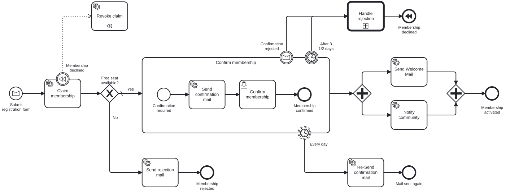
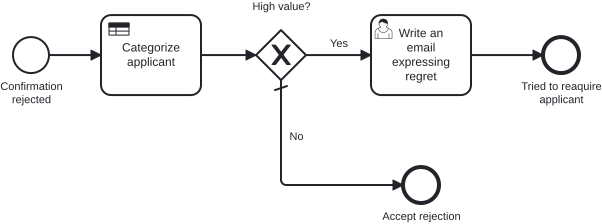

# Aufgabe 6 – Kompensation, Call Activity und DMN

> **Voraussetzung:** Aufgabe 5 ist abgeschlossen – Subprozess, Boundary Events und Parallelzweige laufen.
> **Arbeitsverzeichnis:** `services/process-application`
> **Neu in dieser Aufgabe:** Kompensation (Compensation Boundary Event, Kompensations-Handler, Compensating End Event), Call Activity mit In-Mapping, DMN-Entscheidungstabelle, Business Rule Task.

## Darum geht es

In Aufgabe 5 liegt `revokeClaim` im Sequenzfluss jedes Abbruchpfads. Mit jedem neuen Abbruchpfad
müsstest du ihn erneut einbauen. **BPMN-Kompensation** deklariert stattdessen einmal, welche
Aktivität welche andere rückgängig macht, und die Engine ruft den Handler beim Abbruch selbst auf.

Außerdem will Miravelo abgelehnte Bewerberinnen und Bewerber zwischen 21 und 29 nicht kampflos
ziehen lassen. Die Ablehnungsbehandlung wandert deshalb in einen **eigenen Prozess**, aufgerufen
über eine **Call Activity**. Wer die Zielgruppe ist, entscheidet eine **DMN-Entscheidungstabelle**,
die der Fachbereich später selbst pflegen kann.

## Lernziele

Nach dieser Aufgabe kannst du

- einen Kompensations-Handler deklarieren und über ein Compensating End Event auslösen,
- Kompensation von einem Transaktions-Rollback unterscheiden,
- einen Prozessteil in eine eigene Prozessdefinition auslagern und per Call Activity mit In-Mapping aufrufen,
- eine DMN-Entscheidungstabelle über einen Business Rule Task auswerten.

## Ziel-Modell

Hauptprozess:



Aufgerufener Prozess `handleRejection`:



Referenzmodelle: `../../models/exercise-06/membership.bpmn`,
`../../models/exercise-06/membership-rejection.bpmn`,
`../../models/exercise-06/categorize-applicant.dmn`

## Aufgabe

### 1. Den Kompensations-Handler deklarieren

Hänge ein Compensation Boundary Event an den reservierenden Task und verbinde es per Association mit
dem Task, der die Reservierung rückgängig macht:

| Element | Typ | Element-ID | Konfiguration |
|---|---|---|---|
| Kompensations-Boundary | Compensation Boundary Event | `event_compensateClaim` | hängt an `serviceTask_claimMembership` |
| Verknüpfung | Association | `association_compensateClaim` | vom Boundary auf `serviceTask_revokeClaim` |
| Handler | Service Task | `serviceTask_revokeClaim` | `isForCompensation="true"`, Delegate bleibt `#{revokeClaimDelegate}` |

Der Handler hat damit keinen eingehenden und keinen ausgehenden Sequenzfluss mehr.

### 2. Das End Event zum Auslöser machen

Wandle `endEvent_membershipDeclined` in ein **Compensating End Event** um. Erreicht eine Instanz
dieses End Event, kompensiert die Engine alle abgeschlossenen Aktivitäten mit Handler, hier also
`claimMembership`.

### 3. Die DMN-Entscheidungstabelle modellieren

Lege in einem DMN-Modeler `src/main/resources/dmn/categorize-applicant.dmn` an. IDs und Typen
müssen exakt stimmen, damit der Business Rule Task die Entscheidung findet:

| Eigenschaft | Wert |
|---|---|
| Decision ID | `categorizeApplicant` |
| Hit Policy | `FIRST` |
| Input | `age` (integer) |
| Output | `isHighValue` (boolean) |
| Regeln | `[21..29]` → `true`; Default `-` → `false` |

Die FEEL-Range `[21..29]` schließt beide Grenzen ein. Alle `*.dmn` unter `src/main/resources`
werden beim Start deployt. Wer den DMN-Editor überspringen will, kopiert
`models/exercise-06/categorize-applicant.dmn` ins Modul.

### 4. Den Prozess `handleRejection` modellieren

Lege `src/main/resources/bpmn/membership-rejection.bpmn` mit dem Prozess-Key `handleRejection` an:

| Element | Typ | Element-ID | Name | Konfiguration |
|---|---|---|---|---|
| Start | None Start Event | `startEvent_confirmationRejected` | Confirmation rejected | – |
| Kategorisierung | Business Rule Task | `businessRuleTask_categorizeApplicant` | Categorize applicant | Decision Ref `categorizeApplicant`, Result Variable `isHighValue`, Map Decision Result `singleEntry` |
| Verzweigung | Exclusive Gateway | `gateway_highValue` | High value? | Default-Flow: Nein-Pfad |
| Persönlicher Kontakt | User Task | `userTask_writeRegretMail` | Write an email expressing regret | `asyncAfter="true"` |
| Ende Ja-Pfad | End Event | `endEvent_triedToReacquire` | Tried to reaquire applicant | – |
| Ende Nein-Pfad | End Event | `endEvent_acceptRejection` | Accept rejection | – |

Der Ja-Pfad bekommt die Bedingung `${isHighValue}`.

### 5. Die Call Activity einsetzen

Setze im Hauptprozess eine Call Activity zwischen die beiden Abbruch-Boundary-Events und das
Compensating End Event:

| Element | Typ | Element-ID | Name | Konfiguration |
|---|---|---|---|---|
| Ablehnungsbehandlung | Call Activity | `callActivity_handleRejection` | Handle rejection | Called Element: `handleRejection` |

Eingehende Flows kommen von `event_abortAfter3HalfDays` und `event_confirmationRejected`, der
ausgehende Flow geht auf `endEvent_membershipDeclined`. Lege unter **In Mapping** je ein Paar für
`membershipId` und `age` an. Ohne `age` hat die Entscheidungstabelle keine Eingabe. Im XML entsteht:

```xml
<bpmn:extensionElements>
  <camunda:in source="membershipId" target="membershipId" />
  <camunda:in source="age" target="age" />
</bpmn:extensionElements>
```

### 6. Den Prozess-Test anpassen

Nach `generate-sources` kompilieren die Pfade für Timeout und Rückzug nicht mehr, weil
`serviceTaskRevokeClaim()` nicht mehr im Sequenzfluss liegt. Der neue Pfad läuft über die Call
Activity und endet am Compensating End Event, das den Handler auslöst:

```java
var abortPath = PathWalk.from(FlowNodes.userTaskConfirmMembership())
        .interruptedBy(FlowNodes.subProcessConfirmMembership(), boundary -> boundary.eventAbortAfter3HalfDays())
        .then(next -> next.callActivityHandleRejection())
        .end(next -> next.endEventMembershipDeclined())
        .throwingCompensation(FlowNodes.eventCompensateClaim(), boundary -> boundary.serviceTaskRevokeClaim());
```

Prüfe ihn mit `hasPassed(abortPath.getIds())` statt `hasPassedInOrder`: Die Engine sortiert
durchlaufene Aktivitäten nach ihrem Endzeitpunkt, und der Handler endet vor dem End Event, das ihn
auslöst. Decke dann beide DMN-Zweige ab:

- **Timeout mit Alter 40:** Die Call Activity läuft ohne Wait State durch, danach wird kompensiert.
- **Rückzug mit Alter 25:** Der aufgerufene Prozess wartet an `userTask_writeRegretMail`. Die
  Konstante kommt aus der zweiten generierten API
  (`HandleRejectionProcessApi.FlowNodes.UserTaskWriteRegretMail.ELEMENT_ID`). Schließe den Task ab
  und prüfe denselben Pfad mit `eventConfirmationRejected()`.

Der aufgerufene Prozess ist eine eigene Instanz mit eigenen Jobs. Rufe `continueToNextWaitState`
deshalb **ohne** Instanz-ID auf, sonst bleibt der Job hinter `userTask_writeRegretMail` liegen. Im
Happy Path und bei fehlender Kapazität prüfst du `hasNotPassed` jetzt mit
`CallActivityHandleRejection` statt `ServiceTaskRevokeClaim`.

## Randbedingungen

- Am produktiven Java-Code ändert sich nichts. `RevokeClaimDelegate` ist an das Element gebunden,
  nicht an dessen Position im Fluss.
- Assertions auf der Hauptinstanz sehen die Call Activity, nicht deren Innenleben.
- `mapDecisionResult=singleEntry` funktioniert nur, solange genau eine Regel mit genau einer
  Ausgabe trifft.
- Im High-Value-Zweig wird der Platz erst freigegeben, nachdem der User Task im aufgerufenen
  Prozess abgeschlossen ist.

## Erwartetes Ergebnis

Lehne zwei Anmeldungen mit unterschiedlichem Alter ab. `POST /api/memberships` liefert die ID als
reinen Text:

```bash
MEMBERSHIP_ID=$(curl -s -X POST http://localhost:8080/api/memberships \
  -H "Content-Type: application/json" \
  -d '{"email": "grace@miravelo.com", "name": "Grace", "age": 35}')

curl -X POST http://localhost:8080/api/memberships/$MEMBERSHIP_ID/reject
```

Im Cockpit läuft eine eigene Instanz von `handleRejection` durch und endet an *Accept rejection*.
Danach feuert in der Hauptinstanz das Compensating End Event, im Log erscheint
`Revoking membership claim for …`.

Wiederhole das mit Hanna (`hanna@miravelo.com`, Alter `25`). Diesmal erscheint *Write an email
expressing regret* in der Tasklist. Nach dem Abschließen endet `handleRejection` an *Tried to
reaquire applicant*, und die Hauptinstanz kompensiert.

## Selbstcheck

- [ ] `serviceTask_revokeClaim` trägt `isForCompensation="true"` und liegt nicht mehr im Sequenzfluss
- [ ] `endEvent_membershipDeclined` ist ein Compensating End Event
- [ ] `handleRejection` erscheint im Cockpit als eigene Prozessdefinition, die DMN ist deployt
- [ ] Die Call Activity übergibt `membershipId` und `age`
- [ ] Alter 21–29 führt zum User Task, jedes andere Alter direkt zum End Event
- [ ] Der Prozess-Test ist grün, beide DMN-Zweige sind abgedeckt

## Hinweise

**Kompensation ist kein Rollback.** Ein Rollback macht eine noch nicht committete
Engine-Transaktion rückgängig. Kompensation macht bereits committete Arbeit fachlich rückgängig,
in neuen Transaktionen und lange nach dem Wait State.

**SAGA-Muster:** Jeder Schritt bekommt einen Kompensationsschritt. Scheitert der Ablauf, kompensiert
die Engine die erfolgreichen Schritte in umgekehrter Reihenfolge.

## Referenzlösung

`../../solutions/exercise-06/` – oder direkt laden:

```bash
./mvnw -pl services/process-application antrun:run@load-solution -Dsolution=06
```

## Nächster Schritt

In Aufgabe 7 verlässt du das eine Modul: Eine andere Abteilung bekommt ihren eigenen Service und
ihren eigenen Prozess auf derselben Engine.

➡️ [Weiter zu Aufgabe 7](exercise-07.md)
