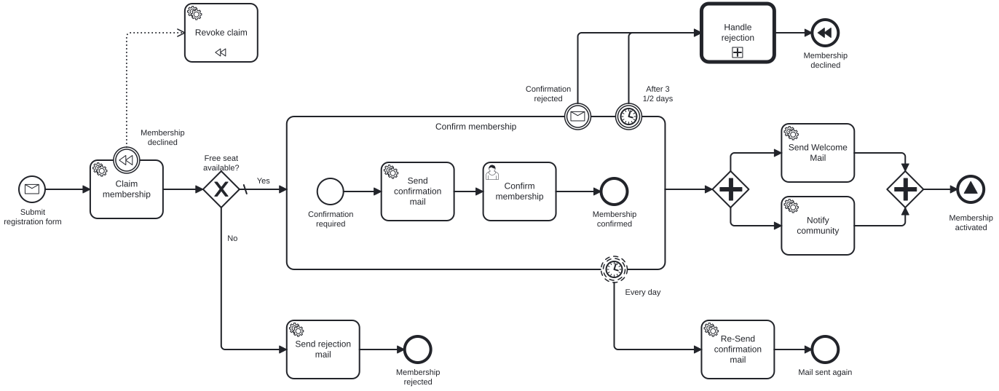
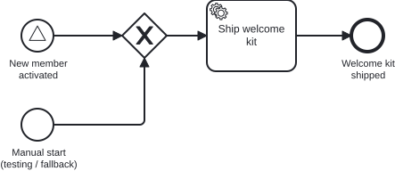

# Aufgabe 7 – Die Engine als geteilte Infrastruktur

> **Voraussetzung:** Aufgabe 6 ist abgeschlossen – der vollständige Membership-Prozess läuft.
> **Arbeitsverzeichnis:** `services/process-application` (Teil A) und `services/logistics-service` (Teil B, wird in dieser Aufgabe angelegt)
> **Neu in dieser Aufgabe:** Signal-End-Event und Signal-Start-Event, External Task, ein zweiter Service als Prozess-Owner, der CIB seven Java-Client für `/engine-rest`.

## Darum geht es

Immer mehr Abteilungen wollen die Engine nutzen, aber niemand will eine eigene betreiben. Die
**Logistik-Abteilung** bekommt deshalb einen eigenen Service mit einem eigenen Prozess
`sendWelcomeKit`. Der Service besitzt das Modell, deployt es selbst in die geteilte Engine und
verschickt ein Welcome-Kit, sobald der Membership-Prozess ein neues Mitglied meldet. Der Kernpunkt
ist die Eigentümerschaft: Modell, Worker, Deployment und Tests liegen beim Logistik-Service, die
Engine führt den Prozess nur aus.

> **Begriff: Signal und Broadcast.** Ein Signal richtet sich nicht an eine bestimmte Instanz wie
> eine Nachricht, sondern an alle, die darauf hören. Der Werfer kennt seine Empfänger nicht und
> wartet auf keine Antwort.

## Lernziele

Nach dieser Aufgabe kannst du

- ein Signal mit Payload über ein Signal-End-Event werfen und einen Prozess per Signal-Start-Event starten,
- einen Service Task als External Task auslegen und mit einem Worker erfüllen,
- die Engine mit dem typisierten CIB seven Java-Client über `/engine-rest` ansteuern,
- ein Modell aus einem fremden Service heraus idempotent deployen.

## Ziel-Architektur

Ab jetzt laufen zwei Anwendungen auf einer Engine:

```
process-application  (Engine-Host – eingebettete Engine + /engine-rest + Cockpit, :8080)
  • besitzt den Membership-Prozess
  • neu: das End Event "Membership activated" wirft Signal_MemberActivated {name}
  • kennt die Logistik nicht und trägt kein send-welcome-kit.bpmn

logistics-service  (Remote-Owner – eigene JVM, :8090)
  • CIB seven Java-Client (cibseven-engine-rest-client-complete-springboot-starter)
  • deployt send-welcome-kit.bpmn beim Start per REST (idempotent, Auto-Deployment des Clients)
  • erfüllt den Service Task shipWelcomeKit als External Task   (Engine → Worker)
  • startet Prozesse über den typisierten Client                  (Worker → Engine)
  • besitzt eigene Tests (In-Memory-Engine nur im Test-Scope)
```

## Ziel-Modell

Membership-Prozess (`subscribeNewsletter`): Das End Event „Membership activated" wirft
`Signal_MemberActivated`.



Logistik-Prozess (`sendWelcomeKit`): Signal-Start und manueller Start, dann der External Task
`shipWelcomeKit`.



Referenzmodelle: `../../models/exercise-07/membership.bpmn`,
`../../models/exercise-07/send-welcome-kit.bpmn`

## Aufgabe

### 0. Baseline sicherstellen

Hast du Aufgabe 6 abgeschlossen, ist `services/process-application` im richtigen Zustand. Steigst
du hier ein, lade die Baseline und danach das Maven-Projekt in IntelliJ neu:

```bash
./mvnw -pl services/process-application antrun:run@load-solution -Dsolution=06
```

### 1. Den Logistik-Service anlegen

Kopiere die Vorlage nach `services/`:

```bash
cp -R templates/exercise-07/logistics-service services/logistics-service
```

Trage das Modul in der Root-`pom.xml` unter `<modules>` ein. Es kompiliert schon im
Ausgangszustand:

```xml
<module>services/logistics-service</module>
```

### Teil A – Engine-Host

### 2. Das End Event zum Signalwerfer machen

Wandle `endEvent_membershipActivated` in ein **Signal-End-Event** mit dem Signal
`Signal_MemberActivated` um und setze `asyncBefore`. Die Payload `name` gibst du über ein
**In Mapping** mit. Im XML entsteht:

```xml
<bpmn:endEvent id="endEvent_membershipActivated" name="Membership activated" camunda:asyncBefore="true">
  <bpmn:signalEventDefinition signalRef="Signal_MemberActivated">
    <bpmn:extensionElements>
      <camunda:in source="name" target="name" />
    </bpmn:extensionElements>
  </bpmn:signalEventDefinition>
</bpmn:endEvent>
```

Die Engine wirft das Signal selbst, ohne Delegate und ohne `RuntimeService`.

### Teil B – Logistik-Service

Arbeite die `TODO Exercise 7`-Stellen im Logistik-Service der Reihe nach ab.

### 3. Den Prozess modellieren

Modelliere `src/main/resources/bpmn/send-welcome-kit.bpmn`. Die Datei enthält nur ein leeres Modell
mit einem Start Event:

| Element | Typ | Element-ID | Konfiguration |
|---|---|---|---|
| Prozess | – | `sendWelcomeKit` | `isExecutable="true"`, `historyTimeToLive` gesetzt |
| Produktions-Start | Signal Start Event | `startEvent_memberActivated` | Signal `Signal_MemberActivated`, `asyncBefore="true"` |
| Manueller Start | None Start Event | `startEvent_manualStart` | für Test und erneuten Versand |
| Zusammenführung | Exclusive Gateway | `gateway_start` | führt beide Starts zusammen |
| Versand | Service Task | `serviceTask_shipWelcomeKit` | Implementation **External**, Topic `shipWelcomeKit` |
| Ende | End Event | `endEvent_welcomeKitShipped` | – |

Das None Start Event erlaubt einen Start per `startProcessInstanceByKey`, etwa um ein Kit erneut zu
verschicken.

### 4. Die Process-API generieren

Aktiviere in der `pom.xml` des Logistik-Services den Block `bpmn-to-code`. Er erzeugt die Konstante
`ServiceTasks.SHIP_WELCOME_KIT`.

```bash
./mvnw -pl services/logistics-service generate-sources
```

Danach liegt `SendWelcomeKitProcessApi` unter `src`.

### 5. Client und Deployment nachvollziehen

Der Logistik-Service nutzt den
[CIB seven Java-Client](https://github.com/cibseven-community-hub/cibseven-rest-client-java)
(`cibseven-engine-rest-client-complete-springboot-starter`). Er ist schon in der `pom.xml` eingetragen
und bringt drei Dinge mit:

- den typisierten `/engine-rest`-Client: `ProcessDefinitionApi` & Co. als fertige Beans
  (`org.cibseven.community.rest.client.*`),
- den External-Task-Client für den Worker,
- das Auto-Deployment: Beim Start schickt er die BPMN-Dateien aus `cibseven.auto-deploy.bpmn-resources`
  in die Engine. Ein Neustart erzeugt kein zweites Deployment.

Schau dir die Konfiguration in `application.yaml` an. Die Engine muss laufen, bevor der Service startet,
sonst bricht der Start beim Deployment ab.

### 6. Den Worker schreiben

Mach `ShipWelcomeKitWorker` zur Bean (`@Component`), lass ihn von `BaseExternalTaskWorker` erben und
abonniere den Topic (`@ExternalTaskSubscription(topicName = ServiceTasks.SHIP_WELCOME_KIT)`). Er
liest die Variable `name`, verschickt das Kit über den Use Case und schließt den Task ab.

### 7. Die Engine über den Client ansteuern

Injiziere die `ProcessDefinitionApi` in `RemoteWelcomeKitProcessAdapter` und starte den Prozess per
`startProcessInstanceByKey`. Die checked `ApiException` des Clients verpackst du in eine unchecked
Exception. Das steckt hinter
`POST /api/welcome-kits`.

## Randbedingungen

- Der Host trägt kein `send-welcome-kit.bpmn`.
- „Remote" ist die Sicht des Clients. Eine Standalone-Engine (CIB Seven Run) ergäbe dasselbe Bild.
- Der Aufbau folgt dem Blueprint
  [`process-engine-blueprints/examples/cibseven-remote`](https://github.com/Miragon/process-engine-blueprints/tree/main/examples/cibseven-remote/java-maven)
  (Java/Maven-Variante).

## Erwartetes Ergebnis

Die Tests des Logistik-Services laufen ohne Engine-Host: Worker-Unit-Test, Prozesstest auf der
In-Memory-Engine und ein Adapter-Test gegen eine gemockte `ProcessDefinitionApi`.

```bash
./mvnw -pl solutions/exercise-07/logistics-service test
./mvnw -pl solutions/exercise-07/process-application test -Dtest=MembershipProcessTest
```

Für den End-to-End-Durchlauf brauchst du drei Terminals:

```bash
# Terminal 1: Engine-Host (:8080)
cd solutions/exercise-07/process-application && ../../../mvnw spring-boot:run

# Terminal 2: Logistik-Service (:8090), deployt sein Modell beim Start
cd solutions/exercise-07/logistics-service && ../../../mvnw spring-boot:run

# Terminal 3: Deployment prüfen, Mitglied anlegen und bestätigen, Kit erneut senden
curl http://localhost:8080/engine-rest/deployment

MEMBERSHIP_ID=$(curl -s -X POST http://localhost:8080/api/memberships \
  -H "Content-Type: application/json" \
  -d '{"email":"jane@example.com","name":"Jane","age":30}')
curl -X POST http://localhost:8080/api/memberships/$MEMBERSHIP_ID/confirm

curl -X POST http://localhost:8090/api/welcome-kits \
  -H "Content-Type: application/json" \
  -d '{"name":"Jane"}'
```

Nach dem Bestätigen feuert das Signal, und eine `sendWelcomeKit`-Instanz läuft. Stoppst du den
Logistik-Service vorher, wartet die Instanz im Cockpit am External Task, bis der Service wieder
läuft und den Task abholt.

## Selbstcheck

- [ ] `send-welcome-kit.bpmn` liegt nur im Logistik-Service und erscheint erst nach dessen Start in den Deployments
- [ ] Ein Neustart des Logistik-Services erzeugt kein zweites Deployment
- [ ] Ein aktiviertes Mitglied startet eine `sendWelcomeKit`-Instanz, der Worker verschickt das Kit
- [ ] Die Membership-Aktivierung wartet nicht auf die Logistik
- [ ] Die Tests des Logistik-Services sind grün, ohne dass der Engine-Host läuft

## Hinweise

**Ein Signal wird in der Transaktion des Werfers zugestellt.** Ohne Marker liefe die neue
`sendWelcomeKit`-Instanz bis zum External Task in der Aktivierungstransaktion mit, und ein Fehler
dort würde die Aktivierung zurückrollen. Deshalb stehen `asyncBefore` am Signal-End-Event und am
Signal-Start-Event.

**Der External Task bringt seine Transaktionsgrenze mit.** Die Engine committet beim Anlegen des
Tasks. Der Worker arbeitet in seiner eigenen Transaktion und meldet `complete` oder `handleFailure`.
Ein Fehler im Worker rollt in der Engine nichts zurück, über Wiederholungen entscheidet der Worker.

## Referenzlösung

- Engine-Host: `../../solutions/exercise-07/process-application/`
- Logistik-Service: `../../solutions/exercise-07/logistics-service/`
- Den Engine-Host-Teil ins Arbeitsmodul laden:
  `./mvnw -pl services/process-application antrun:run@load-solution -Dsolution=07`

## Nächster Schritt

🎉 **Geschafft!** Die Extra-Aufgabe baut den Prozess engine-neutral um.

➡️ [Weiter zur Extra-Aufgabe 1](extra-task-1.md)
