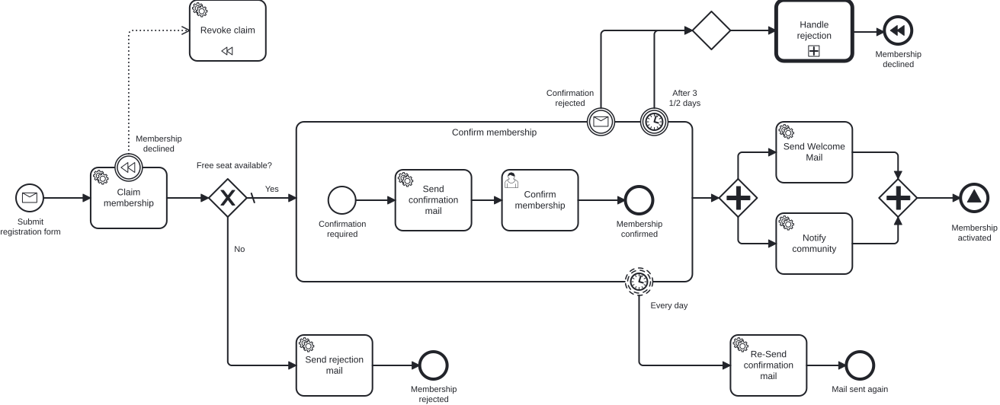

# Extra-Aufgabe 1 – Raus aus dem Engine-Lock-in

> **Voraussetzung:** Aufgabe 7 ist abgeschlossen – der Membership-Prozess läuft vollständig, inklusive Signal-End-Event „Membership activated".
> **Arbeitsverzeichnis:** `services/process-application`
> **Neu in dieser Aufgabe:** Process-Engine-API von bpm-crafters, Worker-Pattern statt JavaDelegate, engine-neutraler Outbound-Adapter, ArchUnit-Guardrail.

## Darum geht es

Jeder Service Task hängt an einem `JavaDelegate` mit `DelegateExecution`, der Prozess-Adapter ruft
`RuntimeService` und `TaskService` direkt auf. Ein Wechsel auf Camunda 8 oder Operaton hieße, jede
dieser Stellen anzufassen. Die [**Process-Engine-API**](https://github.com/bpm-crafters/process-engine-api)
von bpm-crafters abstrahiert die Engine, so wie JPA die Datenbank abstrahiert. Ein Engine-Wechsel
wird damit im Wesentlichen zum Tausch eines Adapters. Domain, Application-Services und Ports bleiben
unangetastet, du änderst nur die Adapter-Schicht.

> *„Schön, dass alles läuft. Aber was passiert, wenn wir in zwei Jahren die Engine wechseln müssen?"*
> — Die Person, die schon mal eine Migration mitgemacht hat.

## Lernziele

Nach dieser Aufgabe kannst du

- Service Tasks über das Worker-Pattern (`@ProcessEngineWorker`) statt über `DelegateExpression` anbinden,
- Prozesse engine-neutral starten, Nachrichten korrelieren und User Tasks abschließen,
- begründen, warum External Tasks die `asyncBefore`-Marker überflüssig machen,
- per Architektur-Test garantieren, dass kein `org.cibseven.bpm`-Import mehr im Code steht.

## Ziel-Modell

Das Modell ändert sich fachlich nicht, nur die technische Anbindung der Service Tasks.

Hauptprozess:



Aufgerufener Prozess `handleRejection`:


## Aufgabe

Kopiere am besten deine Lösung aus Aufgabe 6 und baue sie Schritt für Schritt um. Der
Logistik-Service aus Aufgabe 7 bleibt unverändert.

### 1. Dependencies einbinden

Ergänze in der `pom.xml` des Moduls:

- `dev.bpm-crafters.process-engine-api:process-engine-api`
- `dev.bpm-crafters.process-engine-worker:process-engine-worker-spring-boot-starter`
- `dev.bpm-crafters.process-engine-adapters:process-engine-adapter-cib-seven-embedded-spring-boot-starter`

Der CIB-Seven-Embedded-Adapter ist die Abhängigkeit, die du beim Engine-Wechsel tauschen würdest.

### 2. Service Tasks auf External Tasks umstellen

Stelle im Modeler bei allen sieben Service Tasks **Implementation** auf **External**, setze das
Topic und lege unter **Input/Output** ein Input-Mapping für `membershipId` an: `claimMembership`,
`sendConfirmationMail`, `sendWelcomeMail`, `sendRejectionMail`, `reSendConfirmationMail`,
`revokeClaim` (auch als Kompensations-Handler) und `notifyCommunity`. Im XML entsteht zum Beispiel:

```xml
<bpmn:serviceTask id="serviceTask_sendConfirmationMail" name="Send confirmation mail"
                  camunda:type="external" camunda:topic="sendConfirmationMail">
  <bpmn:extensionElements>
    <camunda:inputOutput>
      <camunda:inputParameter name="membershipId">${membershipId}</camunda:inputParameter>
    </camunda:inputOutput>
  </bpmn:extensionElements>
```

### 3. Delegates durch Worker ersetzen

Ersetze jeden Delegate durch einen Worker ohne `org.cibseven.bpm`-Import:

```java
@Component
public class SendConfirmationMailWorker {

    private final SendConfirmationMailUseCase useCase;

    public SendConfirmationMailWorker(SendConfirmationMailUseCase useCase) {
        this.useCase = useCase;
    }

    @ProcessEngineWorker(topic = ServiceTasks.SEND_CONFIRMATION_MAIL)
    public void sendConfirmationMail(@Variable(name = "membershipId") String membershipId) {
        useCase.sendConfirmationMail(new MembershipId(UUID.fromString(membershipId)));
    }
}
```

Der `claimMembership`-Worker gibt das Ergebnis für das Gateway zurück:

```java
@ProcessEngineWorker(topic = ServiceTasks.CLAIM_MEMBERSHIP)
public Map<String, Object> claimMembership(@Variable(name = "membershipId") String membershipId) {
    var hasEmptySpots = useCase.claimMembership(new MembershipId(UUID.fromString(membershipId)));
    return Map.of("hasEmptySpots", hasEmptySpots);
}
```

### 4. Den Outbound-Adapter umstellen

Ersetze `RuntimeService` durch `StartProcessApi` und `CorrelationApi`:

```java
@Override
public void startProcess(Membership membership) {
    var membershipId = membership.id().value().toString();
    startProcessApi.startProcess(new StartProcessByMessageCmd(
            Messages.SUBSCRIPTION_REQUESTED.getValue(),
            Map.of(
                    "membershipId", membershipId,
                    "email", membership.email().value(),
                    "name", membership.name().value(),
                    "age", membership.age().value(),
                    CommonRestrictions.CORRELATION_KEY, membershipId
            )
    )).join();
}

@Override
public void rejectMembership(MembershipId membershipId) {
    var id = membershipId.value().toString();
    correlationApi.correlateMessage(new CorrelateMessageCmd(
            Messages.CONFIRMATION_REJECTED.getValue(),
            Map.of("membershipId", id),
            Correlation.withKey(id),
            CommonRestrictions.builder().withRestriction("useGlobalCorrelationKey", "true").build()
    )).join();
}
```

### 5. Die Bestätigung engine-neutral abschließen

Statt den Task per `TaskService` zu suchen, lässt du dir offene User Tasks von der Engine zustellen.
`UserTaskSupport` aus der Process-Engine-API merkt sich die zugestellten Tasks samt Payload.
Abonniere im Konstruktor des Adapters `userTask_confirmMembership` mit der Variable `membershipId`
und schließe in `confirm(...)` den passenden Task über die `UserTaskCompletionApi` ab:

```java
confirmationTasks.subscribe(taskSubscriptionApi, CommonRestrictions.builder().build(),
        FlowNodes.UserTaskConfirmMembership.ELEMENT_ID, Set.of("membershipId"));

// in confirm(...): Task-ID über getAllTasks() und getPayload(taskId) zur membershipId finden
userTaskCompletionApi.completeTask(new CompleteTaskCmd(/* Task-ID */)).join();
```

### 6. Bootstrap und Konfiguration anpassen

Entferne `@EnableProcessApplication` aus der `TrainingApplication`, der Adapter übernimmt Deployment
und Worker-Registrierung. Stelle einen `EngineCommandExecutor` bereit, der Engine-Commands synchron
im aufrufenden Thread ausführt. So committen Engine-Fortschritt und Fachdaten gemeinsam:

```java
@Bean
public EngineCommandExecutor engineCommandExecutor() {
    return new EngineCommandExecutor(Runnable::run);
}
```

Ergänze in der `application.yaml` den Worker- und Adapter-Block:

```yaml
dev:
  bpm-crafters:
    process-api:
      worker:
        deployment:
          enabled: true
          bpmnResourcePattern: "classpath*:/**/*.bpmn"
          dmnResourcePattern: "classpath*:/**/*.dmn"
      adapter:
        cib-seven-embedded:
          enabled: true
          service-tasks:
            delivery-strategy: embedded_scheduled
            worker-id: extra-task-1-worker
            schedule-delivery-fixed-rate-in-seconds: 5
          user-tasks:
            delivery-strategy: embedded_scheduled
            schedule-delivery-fixed-rate-in-seconds: 5
```

### 7. Guardrail setzen

Ergänze im `ArchitectureTest` eine Regel, die jeden `org.cibseven.bpm`-Import verbietet:

```java
@ArchTest
static final ArchRule no_class_should_depend_on_the_native_engine = noClasses()
        .should().dependOnClassesThat().resideInAPackage("org.cibseven.bpm..");
```

Ist der Test grün, steckt die Engine nur noch in `pom.xml` und `application.yaml`.

## Randbedingungen

- Die `asyncBefore`-Marker an den Service Tasks entfallen. Ein External Task ist ein Wait State: Die
  Engine committet beim Anlegen und wartet, bis ein Worker ihn abschließt.
- Die Topic-Konstanten (`ServiceTasks.*`) stammen aus der generierten Process-API aus
  [Aufgabe 4 · Add-on](exercise-04-addon.md).
- Service Tasks und User Tasks werden per Polling etwa alle 5 Sekunden zugestellt. Ein `confirm`
  direkt nach der Registrierung kann deshalb noch keinen Task finden.

## Erwartetes Ergebnis

Fahre die Szenarien aus Aufgabe 6. Das Verhalten ist identisch, nur laufen Worker statt Delegates:

```bash
MEMBERSHIP_ID=$(curl -s -X POST http://localhost:8080/api/memberships \
  -H "Content-Type: application/json" \
  -d '{"email": "grace@miravelo.com", "name": "Grace", "age": 35}')

curl -X POST http://localhost:8080/api/memberships/$MEMBERSHIP_ID/reject
```

Nach dem Rückzug läuft `handleRejection`, danach kompensiert der Worker `revokeClaim`. Wiederhole das
mit Hanna (Alter `25`): Der aufgerufene Prozess wartet zusätzlich am User Task *Write an email
expressing regret*. Eine dritte Anmeldung, die du nach ein paar Sekunden mit
`POST /api/memberships/$MEMBERSHIP_ID/confirm` bestätigst, endet an `Membership activated`.

## Selbstcheck

- [ ] Alle sieben Service Tasks sind `camunda:type="external"` mit Topic
- [ ] Es gibt keine `JavaDelegate`-Klassen mehr, nur noch `@ProcessEngineWorker`-Worker
- [ ] Der Outbound-Adapter nutzt `StartProcessApi`, `CorrelationApi` und `UserTaskCompletionApi`
- [ ] `@EnableProcessApplication` ist entfernt, die `EngineCommandExecutor`-Bean ist gesetzt
- [ ] Der ArchUnit-Test meldet keine Abhängigkeit auf `org.cibseven.bpm`

## Hinweise

Als Vorlage dient das Repository [**engine-safari**](https://github.com/emaarco/engine-safari),
Modul `cib-seven-with-process-engine-api`.

## Referenzlösung

`../../solutions/extra-task-1/`

## Nächster Schritt

🦁 **Geschafft!** CIB Seven läuft weiter unter der Haube, aber dein Code weiß nichts mehr davon.
