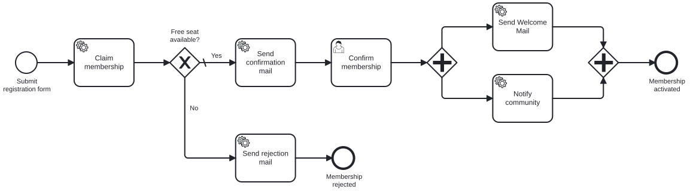

# Exercise 0 – Model the membership flow at the business level

> **Prerequisite:** Chapter 1 – you know BPMN as a notation: Start and End Events, User Task and Service Task, sequence flow, Exclusive Gateway and Parallel Gateway.
> **Working directory:** any folder you like (no code yet, no module yet).
> **New in this exercise:** BPMN modeler, the membership core flow as a shared map.

## What this is about

**Miravelo** is an online shop for premium bikes. For its most loyal customers there is the
**Inner Circle**, a membership with a limited number of seats: whoever wants to join registers,
gets a seat reserved, confirms via double opt-in and is welcomed. Before anything gets automated,
you capture this core flow at the business level. From Exercise 1 on you automate it piece by
piece.

> *"Let's sketch this out before anyone starts coding."*
> — the one sensible sentence in the whole kickoff.

## Learning goals

After this exercise you can

- install a BPMN modeler and create an end-to-end model in it,
- apply the basic shapes from Chapter 1 to a real business process,
- justify where the flow waits for a human and where a condition decides,
- name elements so the business side can read the flow out loud without follow-up questions.

## Target model

## The task

### 1. Install the modeler in your IDE

Install the **Miragon BPMN Modeler** as a
[VS Code extension](https://marketplace.visualstudio.com/items?itemName=miragon-gmbh.vs-code-bpmn-modeler)
or as an [IntelliJ plugin](https://plugins.jetbrains.com/plugin/32634-miragon-bpmn-modeler). Without
VS Code or IntelliJ, use the [desktop app](https://miragon.github.io/bpmn-modeler/). Create a new
BPMN diagram.

### 2. Model registration and capacity check

Model the backbone: a person registers, the flow reserves a seat and checks whether one was free.
If none is free, the application ends with a rejection.

| Type | Name |
|---|---|
| Start Event | Submit registration form |
| Service Task | Claim membership |
| Exclusive Gateway | Free seat available? |
| Service Task | Send rejection mail |
| End Event | Membership rejected |

Connect Start → *Claim membership* → *Free seat available?*. The **No** path leads to *Send
rejection mail* → *Membership rejected*. You fill the **Yes** path in the next step.

### 3. Model the confirmation

Model the **Yes** path: first a confirmation mail goes out, then the person confirms
themselves.

| Type | Name |
|---|---|
| Service Task | Send confirmation mail |
| User Task | Confirm membership |

The User Task waits for a human; the Service Task before it is handled by a system.

### 4. Model the activation in parallel

After the confirmation two things happen at once: the welcome mail goes out, and the community is
notified. Model this with one Parallel Gateway as the fork and one Parallel Gateway as the
join:

| Type | Name |
|---|---|
| Parallel Gateway (fork) | – |
| Service Task | Send Welcome Mail |
| Service Task | Notify community |
| Parallel Gateway (join) | – |
| End Event | Membership activated |

Route *Confirm membership* into the fork, both service tasks in parallel into the join and from
there to *Membership activated*.

### 5. Save the model

Save the file as `membership.bpmn` in a folder of your choice.

## Constraints

- **Business level only.** Element IDs, form fields, Java wiring, `isExecutable` and
  `historyTimeToLive` come from Exercise 2 on.
- **Only the basic shapes from Chapter 1.** Subprocess, boundary events and compensation come
  later.
- **Modelling rules from Chapter 1:** activities as verb plus object, gateways as a question,
  outgoing sequence flows as the answer (*Yes* / *No*), every End Event with its own name. The happy
  path runs straight from left to right, the rejection away below without crossing flows. Fork and
  join are separate gateways.
- **Don't copy it into the module yet.** Under `services/process-application/src/main/resources/bpmn/`
  there is already a rudimentary `membership.bpmn` for Exercise 1.

## Expected result

Your model shows registration, seat reservation, the capacity check with the rejection, the
confirmation at the waiting User Task and the parallel activation. The modeler reports no errors.

## Self-check

- [ ] The flow starts with *Submit registration form* and ends in *Membership activated* or *Membership rejected*
- [ ] Activities are named as verb plus object, the gateway as a question, its paths as *Yes* / *No*
- [ ] The confirmation consists of *Send confirmation mail* and the User Task *Confirm membership*
- [ ] The activation runs through a parallel fork and a parallel join
- [ ] The happy path runs straight, no element is unconnected
- [ ] The file exists as `membership.bpmn`

## Hints

The exceptions get their own exercises later: deadlines, reminder and withdrawal with boundary
events in Exercise 5, undoing a reserved seat as compensation in Exercise 6. Leave out pools, lanes
and data objects: the only human step is *Confirm membership*, everything else is handled by a
system.

## Reference solution

`../../models/exercise-00/membership.bpmn` – open the model in the modeler and compare it with
yours.

## Next step

In Exercise 1 you get the engine running that executes models like this, starting with a tiny
excerpt.

➡️ [Next: Exercise 1](exercise-01.md)
