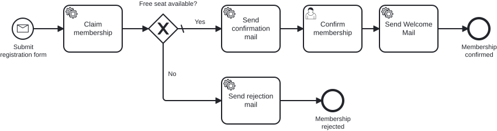

# Exercise 4 – Secure the process with tests

> **Prerequisite:** Exercise 3 is complete – the gateway, the capacity check, and both process outcomes are working.
> **Working directory:** `services/process-application`
> **New in this exercise:** transaction boundaries (`asyncBefore`/`asyncAfter`), in-memory engine with H2, the job executor turned off, `@MockitoBean`, assertions with `BpmnAwareTests`, coverage report (Process Test Coverage).
> **Duration:** 45–60 min

## What this is about

In the Cockpit demo the process worked once. Whether it still works after someone reroutes a
sequence flow, nobody knows. A **process test** starts the real process in an in-memory engine,
runs the real delegates and mocks only the business logic behind them. The path the instance must
take becomes an assertion, checked on every build. First you make the process resilient with
transaction boundaries.

> *"Works on my machine" is not a test strategy. It's an excuse with better PR.*

## Learning goals

After this exercise you can

- set transaction boundaries and explain why a non-repeatable step must commit before an external effect,
- secure a process as a unit test on an in-memory engine with the job executor turned off,
- mock the use cases behind the delegates with `@MockitoBean`,
- check process paths with `BpmnAwareTests` (`isWaitingAt`, `hasPassedInOrder`, `isEnded`) and find untested paths in the coverage report.

## Target model



There are no new elements, only transaction boundaries on the process from Exercise 3.

Reference model: `../../models/exercise-04/membership.bpmn`

## The task

### 1. Set transaction boundaries

So far the process runs synchronously, and the engine commits only at wait states. An
**asynchronous continuation** (`asyncBefore` or `asyncAfter`, Properties Panel → *Asynchronous
Before/After*) makes the engine commit, create a job and continue in a new transaction. Theory:
training chapter **"Async & Transaction Boundaries"**.

There is no wait state between the Message Start and the User Task. Without markers,
`claimMembership` and `sendConfirmationMail` run in one transaction. If the mail send throws, the
engine rolls everything back and retries the job, and the spot gets reserved twice. The rule:
separate non-repeatable work from the external effect with its own boundary.

| Marker | Element | Why |
|---|---|---|
| `asyncBefore` | `startEvent_submitRegistration` | The correlation only creates the instance and returns |
| `asyncAfter` | `userTask_confirmMembership` | The completion commits immediately instead of rolling back with an error in the next task |
| `asyncBefore` | `serviceTask_sendConfirmationMail` | The reservation commits first, a mail failure only retries the send |
| `asyncBefore` | `serviceTask_sendRejectionMail` | otherwise sits in the same transaction as `claimMembership` |
| `asyncBefore` | `serviceTask_sendWelcomeMail` | external effect, like all mail tasks |

`claimMembership` gets no marker: it commits together with the **token**, the imagined game piece
that marks the current state of an instance in the model.

### 2. Enable the test dependencies

In `services/process-application/pom.xml`, uncomment the `TODO Exercise 4` block. As in
Exercise 1, delete only the lines `<!--` and `-->` between `@exercise-4:begin` and
`@exercise-4:end`. Afterwards these dependencies are active:

```xml
<dependency>
    <groupId>org.cibseven.bpm</groupId>
    <artifactId>cibseven-bpm-assert</artifactId>
    <scope>test</scope>
</dependency>
<dependency>
    <groupId>org.cibseven.community.process_test_coverage</groupId>
    <artifactId>cibseven-process-test-coverage-spring-test-platform-7</artifactId>
    <scope>test</scope>
</dependency>
<dependency>
    <groupId>org.jetbrains.kotlin</groupId>
    <artifactId>kotlin-reflect</artifactId>
    <scope>test</scope>
</dependency>
```

Process Test Coverage, a CIB seven community extension, writes a report per test class showing which
elements the tests passed. It needs `kotlin-reflect` but does not declare it.

### 3. Create the test profile

Create `src/test/resources/application-test.yaml`. The `test` profile runs the engine on its own
in-memory H2 and turns the job executor off:

```yaml
spring:
  main:
    allow-bean-definition-overriding: true
  datasource:
    url: jdbc:h2:mem:cibseven-test;DB_CLOSE_DELAY=-1
    username: sa
    password:
    driver-class-name: org.h2.Driver
  jpa:
    hibernate:
      ddl-auto: create-drop

camunda:
  bpm:
    admin-user:
      id: admin
      password: admin
    database:
      type: h2
      schema-update: true
    job-execution:
      enabled: false   # the test runs the async continuations itself
    webapp:
      enabled: false

# The webapp validates this secret at start-up, even when it is turned off
cibseven:
  webclient:
    authentication:
      jwtSecret: M9nU3ORo3s+gK23D9mO5I2h+EIqnosCFDCJi+2bKoulKqZkeQT8pGYg5RhuORlf/fWhLu5meC/SPZCv9NNuj6SK/vE5Sid04UQGrnyh04EpBdiAosAO91xezjgmbSeALUtneibseGpS0tNE4RvLIl+gXiAKqNXyO
```

> **Term: job executor.** The engine's background thread that works through the jobs from
> asynchronous continuations. In a test you would never know how far the instance is, so the test
> runs the jobs itself.

### 4. Write the happy-path test

Replace the placeholder in `src/test/java/io/miragon/training/process/MembershipProcessTest.java`
(marked with `TODO Exercise 4`). To drive the instance, use the provided helper
`process/util/ProcessEngineTestUtils`:

- `continueToNextWaitState(processEngine)` executes the open jobs until the instance reaches its
  next wait state or its end.
- `findProcessInstance(runtimeService, membershipId)` looks up the instance for the `membershipId`.

The scaffold is the same for every process test:

```java
@SpringBootTest
@ActiveProfiles("test")
class MembershipProcessTest {

    @Autowired private MembershipProcess membershipProcess;
    @Autowired private RuntimeService runtimeService;
    @Autowired private TaskService taskService;
    @Autowired private ProcessEngine processEngine;

    @MockitoBean private ClaimMembershipUseCase claimMembershipUseCase;
    @MockitoBean private SendConfirmationMailUseCase sendConfirmationMailUseCase;
    @MockitoBean private SendRejectionMailUseCase sendRejectionMailUseCase;
    @MockitoBean private SendWelcomeMailUseCase sendWelcomeMailUseCase;

    @BeforeEach
    void setUp() {
        init(processEngine); // BpmnAwareTests.init(...)
    }
}
```

The happy path follows the Given – When – Then shape. Replace each placeholder `"<…>"` with the
element ID from your model:

```java
@Test
void happyPath_membershipIsConfirmedAndWelcomeMailIsSent() {
    // Given: the capacity check grants a spot
    when(claimMembershipUseCase.claimMembership(any())).thenReturn(true);

    // When: the instance starts and runs to the first wait state
    Membership membership = new Membership(new Email("jane@example.com"), new Name("Jane"), new Age(30));
    membershipProcess.startProcess(membership);
    ProcessInstance instance = findProcessInstance(runtimeService, membership.id().value().toString());
    continueToNextWaitState(processEngine);

    // Then: the instance waits at the user task
    assertThat(instance).isWaitingAt("<user-task-id>");

    // When: the user task is completed
    String taskId = taskService.createTaskQuery()
            .processInstanceId(instance.getProcessInstanceId()).singleResult().getId();
    taskService.complete(taskId);
    continueToNextWaitState(processEngine);

    // Then: the instance ends along the confirm path
    assertThat(instance)
            .isEnded()
            .hasPassedInOrder("<start>", "<…confirm-path activities, in order…>", "<confirmed-end>")
            .hasNotPassed("<reject-activity>", "<rejected-end>");

    verify(sendWelcomeMailUseCase).sendWelcomeMail(membership.id());
}
```

### 5. See what your test covers

Create `src/test/resources/META-INF/spring/org.springframework.boot.autoconfigure.AutoConfiguration.imports`
with this line. It switches the coverage on for every Spring Boot test; the test class stays as it is:

```text
org.cibseven.community.process_test_coverage.spring_test.platform7.ProcessEngineCoverageConfiguration
```

Run the test (command under *Expected result*) and open
`target/process-test-coverage/io.miragon.training.process.MembershipProcessTest/report.html`.
Green elements were reached by a test, white ones never. The rejection path is still white: 13 of
17 elements (sequence flows count too), about 76 %.

### 6. Test the rejection path

Write the second test, `noCapacity_membershipIsRejected`: `claimMembership` returns `false`, the
instance runs without a wait state to `endEvent_membershipRejected`. Check that the rejection mail
was passed, the confirmation and the welcome mail were not, and that `sendWelcomeMailUseCase` was
never called (`verify(..., never())`). Run the test class again and reload the report.

## Constraints

- The test needs no running application. The in-memory H2 is fresh for each run, independent of
  `~/.cibseven-training`.
- Only the use cases get mocked. Delegates, model, and engine run for real.

## Expected result

Run the test class from the root directory:

```bash
./mvnw -pl services/process-application test -Dtest=MembershipProcessTest
```

Both tests pass in a few seconds. If one fails, the assertion shows at which activity the instance
actually stood. The coverage report shows the model fully green.

## Self-check

- [ ] `asyncBefore` is on the Message Start Event and on the three mail tasks, `asyncAfter` on the User Task, `claimMembership` has no marker
- [ ] The job executor is turned off in the test profile
- [ ] The happy-path test checks the order and the paths not taken
- [ ] The rejection test checks that the welcome mail was never called
- [ ] Both tests pass green without the application running
- [ ] The coverage report shows every element of the model green

## Hints

**Idempotency:** A retry may re-execute a Service Task. If an action may happen only once
(reservation, payment), it must commit before the boundary or be idempotent.

**Coverage as a quality gate (optional):** A static nested `@TestConfiguration` with a
`ProcessEngineCoverageProperties` bean and `assertClassCoverageAtLeast(1.0)` fails the build below
100 %. Comment out a test and the build fails.

## Reference solution

`../../solutions/exercise-04/` – or load it directly:

```bash
./mvnw -pl services/process-application antrun:run@load-solution -Dsolution=04
```

The solution contains both variants: `MembershipProcessPlainTest` with ID strings and
`MembershipProcessTest` with the generated Process-API from the add-on.

## Next step

The element IDs are still hand-typed strings in the test. The add-on turns them into verified
constants.

➡️ [Next — Add-on: bpmn-to-code](exercise-04-addon.md)
